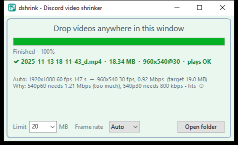
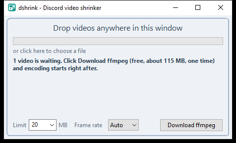
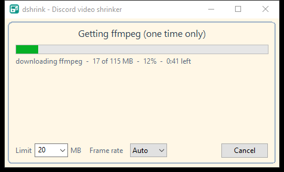
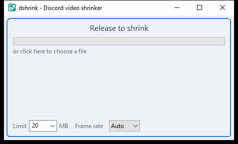
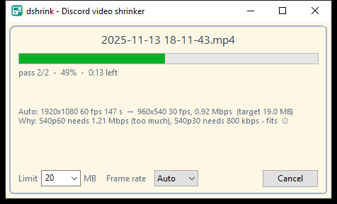
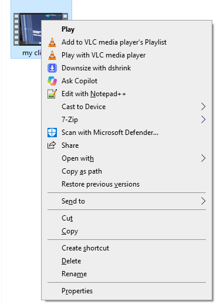
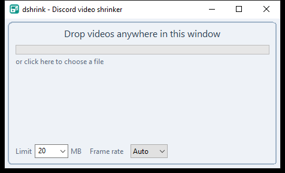

# Video Downsampler (dshrink)


**Make any video small enough for Discord: drop it on a tiny window and
you're done.**

dshrink re-encodes a video so it fits under Discord's upload limit (20 MB for
free accounts) at the **best quality that fits**. It works out the bitrate,
picks the highest resolution and frame rate that still look good at that
bitrate, encodes with 2-pass x264, checks the result really is under the
limit, and makes sure the file plays. You don't click anything after the drop.

<p align="center">
  
</p>

- **One 72 KB `.exe`:** a native Win32 app in plain C with no runtime, no
  installer and no Python. It opens instantly (about 0.1 s). On first use it
  can fetch ffmpeg for you in one click.
- **Automatic quality ladder:** a short clip stays 1080p60. A longer one steps
  down to 720p, 540p, 30 fps... only as far as it has to.
- **Hits the size every time:** 2-pass encoding, then a size check, and a
  slightly smaller re-encode if it ever overshoots.
- **Right-click in Explorer:** choose **Downsize with dshrink** on any video.
- **Safe:** writes `name_d.mp4` next to the original. It never changes the
  source and never overwrites a file.

## Download

**[⬇ Download dshrink.exe](https://github.com/weighta/Video-Downsampler/releases/latest/download/dshrink.exe)**
(latest release, Windows 10/11 64-bit), put it in any folder, and run it.
There's nothing to install. All versions are on the
[Releases](https://github.com/weighta/Video-Downsampler/releases) page.

### First run: one click to get ffmpeg

dshrink does the encoding with [ffmpeg](https://ffmpeg.org/). If ffmpeg isn't
on your PC yet, the window offers to fetch it:

| ffmpeg missing | One click later |
|---|---|
|  |  |

Click **Download ffmpeg** and dshrink:

1. downloads the official "release essentials" Windows build from
   [gyan.dev](https://www.gyan.dev/ffmpeg/builds/) (about 115 MB, one time
   only),
2. checks it against the SHA-256 checksum gyan.dev publishes for that exact
   package,
3. unpacks just `ffmpeg.exe` and its license with Windows' built-in `tar`,
   into a `bin\` folder next to `dshrink.exe` (or
   `%LOCALAPPDATA%\dshrink\bin` if that folder isn't writable),
4. checks the new ffmpeg runs and has the x264 encoder, then starts any videos
   you already dropped.

Nothing downloads until you click, and **Cancel** removes the partial
download. The whole thing takes about a minute on a typical connection.

Already have ffmpeg? dshrink uses it automatically if `ffmpeg.exe` is next to
`dshrink.exe`, in `bin\` beside it, on your PATH (for example after
`winget install Gyan.FFmpeg`), or wherever the `DSHRINK_FFMPEG` environment
variable points.

## How to use it

### 1. Drop videos on the window

Start `dshrink.exe` and drag one or more videos onto it. The whole window is
the drop zone, and its border turns blue when you're over it.

| Drag a video over it | It starts right away | Done |
|---|---|---|
|  |  |  |

While it works you see a progress bar covering both encoding passes and the
playback check, with time remaining. The **Auto** line shows what it picked;
hover the **Why** line to see every option it considered and the bitrate each
one needs. Drop more files at any time and they queue up. **Cancel** stops
and leaves nothing behind. **Open folder** shows the finished file.

You can also click the title line to choose files with a normal Open dialog.

### 2. Or right-click a video in Explorer



Turn it on once: click the icon at the top-left of the dshrink window and tick
**Show "Downsize with dshrink" in Explorer's right-click menu**. You can also
run:

```
dshrink.exe --install-menu
```

After that, right-click any video (or select several) and choose **Downsize
with dshrink**. Only one dshrink window ever opens; extra videos join its
queue. The menu entry is per-user and needs no admin rights. Untick the
option, or run `dshrink.exe --uninstall-menu`, to remove it.

<br clear="right">

### Settings

Just two, both remembered:

| Setting | Default | What it does |
|---|---|---|
| **Limit** | 20 MB | Your upload limit. 20 for free accounts, 50 for Nitro Basic, or type any number. dshrink aims 5 % under it. |
| **Frame rate** | Auto | Auto keeps up to 60 fps when there's room. 30 always caps at 30 fps. |



## What it picks

Typical results with the 20 MB default:

| Your clip | What you get |
|---|---|
| 8 s, 1080p24 | 1080p24, about 10 MB (short clips aren't padded to the limit) |
| 23 s, 1080p60 | 1080p60 |
| 1 min, 1080p60 | 720p60 |
| 2.5 min, 1080p60 | 960×540, 30 fps |
| 8 min, 1080p60 | 640×360, 30 fps (it fits, but consider trimming) |

### How it decides

1. **Budget:** target = limit × 0.95. Total bitrate = target × 8 / duration,
   less 1.5 % for the MP4 container.
2. **Audio:** AAC at 160 kbps when there's plenty of room, stepping down to
   128 / 96 / 64 / 48, and 32 kbps mono for very long clips. It never exceeds
   the original's audio bitrate. Video gets the rest.
3. **Resolution and frame rate:** it tries 1080p60, 1080p30, 720p60, 720p30,
   540p... and takes the first one whose bitrate needs are met. Needs at
   30 fps:

   | short side | 2160 | 1440 | 1080 | 720 | 540 | 480 | 360 | 240 |
   |---|---|---|---|---|---|---|---|---|
   | video kbps | 9000 | 4500 | 2500 | 1300 | 800 | 600 | 250 | 120 |

   60 fps needs about 1.5× (scaled by (fps/30)^0.6). It never upscales, and
   short clips stop at 0.2 bits per pixel per frame instead of filling the
   limit.
4. **Encode:** ffmpeg runs hidden at below-normal priority: `libx264 -preset
   veryslow -profile:v high`, 2-pass ABR with `-maxrate 2× -bufsize 4×`, AAC
   audio, `-movflags +faststart` (HandBrake's "Web Optimized"). Only the
   first video and audio track are kept.
5. **Check:** if the file is over the target, the video bitrate is lowered by
   the overshoot (plus 3 %) and it encodes again, up to 3 times. The final
   file is decoded end to end, and any decoder error is reported.

## Build from source

Needs Visual Studio 2022 with the "Desktop development with C++" workload.

```
build.bat
```

`src\dshrink.c` is a single C file built with `/O1 /GS-`, no C runtime,
linked only against Windows system libraries (kernel32, user32, gdi32,
comctl32, shell32, comdlg32, advapi32, ole32, wininet for the ffmpeg
download, bcrypt for its SHA-256 check). `src\` also holds the icon,
the manifest (visual styles, DPI-aware) and the resource script.

Self-test switches used during development:

- `--selftest-drop FILE` (repeatable): posts a real `WM_DROPFILES` to the
  window.
- `--selftest-ole`: feeds the files to the drag-and-drop target as a shell
  data object instead.
- `--autoclose MS`: closes the window MS milliseconds after the queue
  empties.
- `--log FILE`: writes one `RESULT` line per video.

## License

MIT, see [LICENSE](LICENSE). ffmpeg and x264 are separate projects under
their own (L)GPL licenses and are not part of this repository. The one-click
download fetches gyan.dev's build and saves its license as
`bin\ffmpeg-LICENSE.txt`. This project is not
affiliated with Discord.
